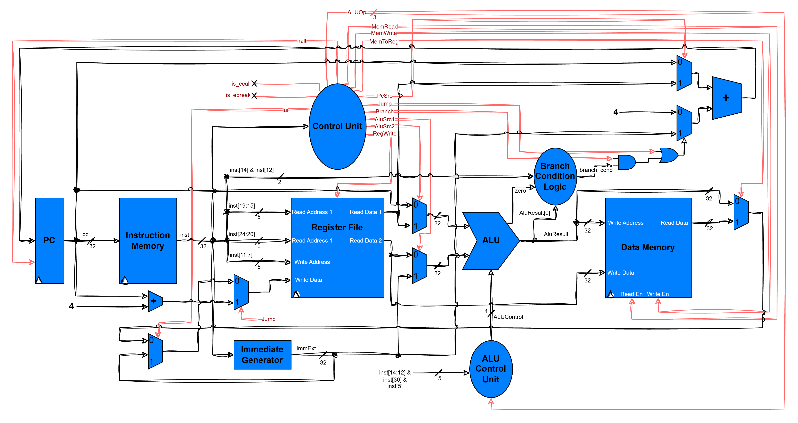
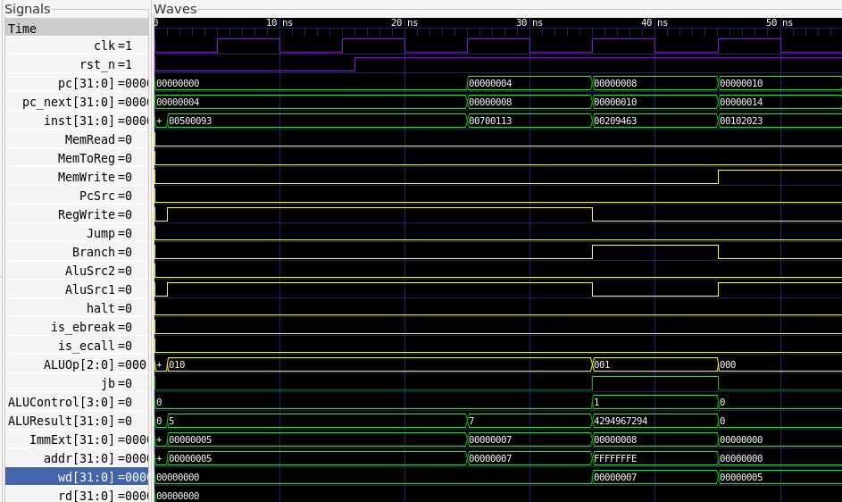

# RV32I Single-Cycle Processor

A single-cycle implementation of the RISC-V RV32I base integer instruction set, written in Verilog and simulated with [Verilator](https://www.veripool.org/verilator/). Every instruction (fetch, decode, execute, memory access, write-back and next-PC selection) completes in exactly one clock cycle.

## Features

- RV32I integer instructions: All instructions except Zicsr.
- Two-level control: a main decoder (`control_unit`) plus an ALU decoder (`alu_control_unit`)
- Self-checking testbenches and a Makefile that builds, runs and opens the waveform (FST + GTKWave)

## Repository layout

| File | Purpose |
|---|---|
| `single_cycle_riscvi32.v` | Top-level module |
| `program_counter.v` | PC register with active-low reset |
| `instruction_memory.v` | Instruction ROM, addressed by PC |
| `control_unit.v` | Main decoder: opcode to control signals |
| `alu_control_unit.v` | ALU decoder: `ALUOp` + `funct3`/`funct7` to `ALUControl` |
| `register_file.v` | 32 x 32-bit registers, two read ports and one write port |
| `immediate_generator.v` | Immediate extraction for I, S, B, U and J formats |
| `alu.v` | 32-bit ALU |
| `data_memory.v` | 1024-word (4 KB) data RAM |
| `alusrc1_mux.v`, `alusrc2_mux.v` | ALU operand selection |
| `jb_mux.v`, `pcsrc_mux.v` | Next-PC adder input selection |
| `memtoreg_mux.v`, `lui_mux.v` | Write-back selection |
| `tb_*.v` | Testbenches |
| `Makefile` | Build, run and waveform targets |

## Architecture overview



## Control signals

Outputs of `control_unit`:

| Signal | Meaning |
|---|---|
| `RegWrite` | Register file write enable |
| `MemWrite` / `MemRead` | Data memory write / read enable |
| `AluSrc2` | ALU operand A: `0` = rs1, `1` = pc |
| `AluSrc1` | ALU operand B: `0` = rs2, `1` = immediate |
| `Branch` | Instruction is a conditional branch |
| `Jump` | Instruction is `jal` or `jalr` |
| `PcSrc` | Next-PC adder base: `0` = pc, `1` = rs1 |
| `MemToReg` | Write back memory data instead of the ALU result |
| `is_ebreak` | System EBREAK |
| `is_ecall` | System ECALL |
| `halt` | Halts the PC (Until CSRs are added to the implementation) |
| `lui` | Bypass: write the upper immediate directly |
| `ALUOp[2:0]` | Coarse ALU operation, refined by `alu_control_unit` |

## Getting started

### Requirements

- Verilator 5.x (needs `--timing` support)
- A C++ toolchain (`g++`, `make`)
- zlib and LZ4 development headers (needed for FST waveforms)
- GTKWave (optional, for viewing waveforms)

### Build and run

```bash
make run      # build and run the simulation
make waves    # open the waveform in GTKWave
make clean    # remove build output and waveform files
```

Select the testbench by setting `TOP` and the testbench file in `SRC` at the top of the `Makefile`.

## Testbench

| Testbench | What it checks |
|---|---|
| `tb_five_instr.v` | `addi`, `addi`, taken `bne` (skips one instruction), `sw`; checks registers and memory |

Each testbench loads its program straight into instruction memory, runs a few cycles, prints PASS/FAIL, and writes a waveform file.

## Waveform



## Known limitations and roadmap

- `pause`, `fence.tso`, `fence` are NOPs
- `ecall`, `ebreak` are halts until CSR instructions are added
- CSR instructions not added yet
- Possible additions: M extension
